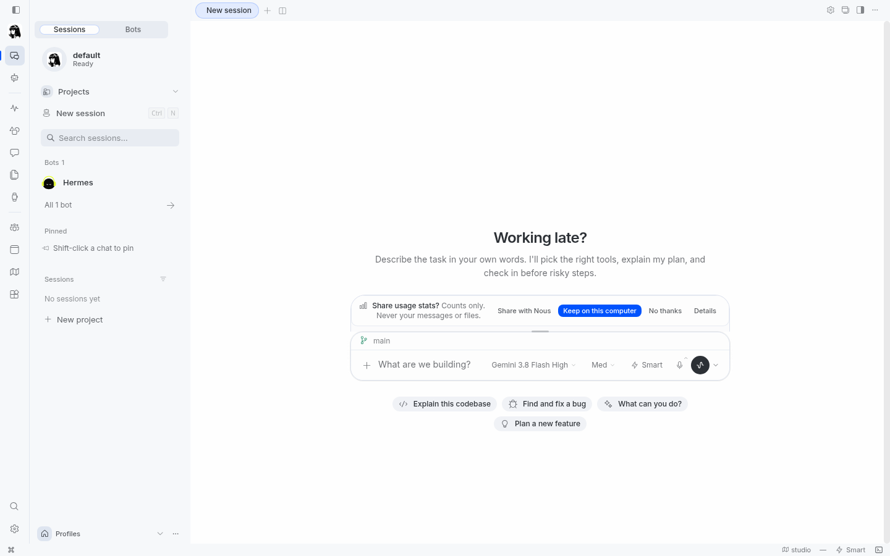
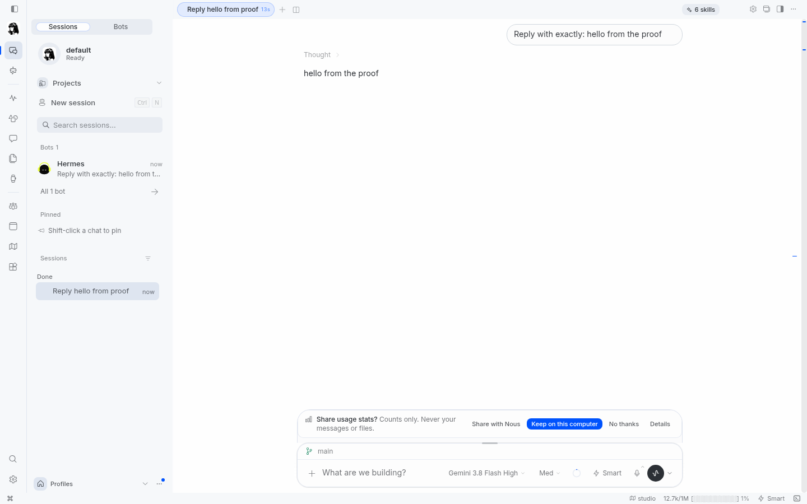
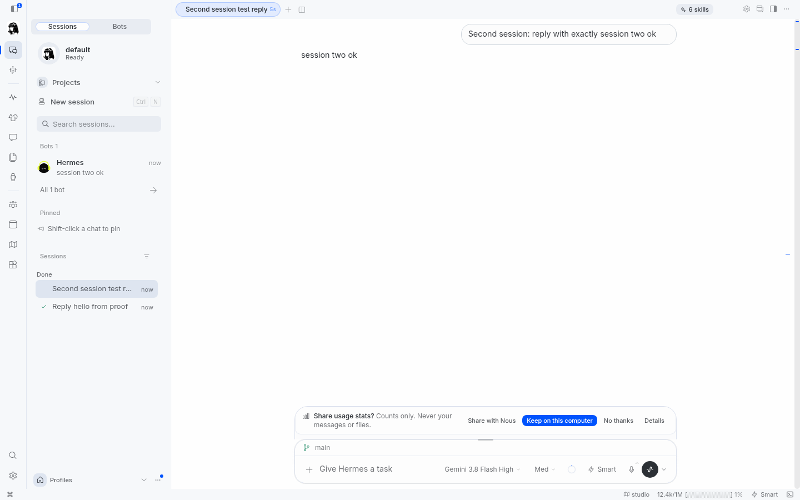
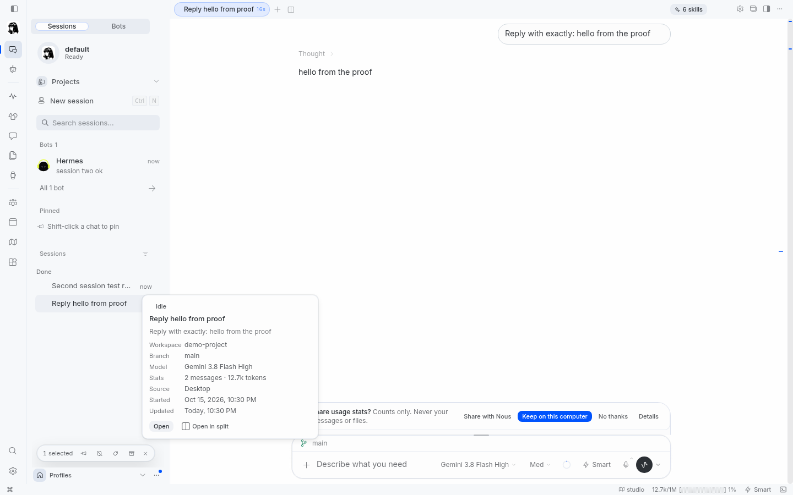
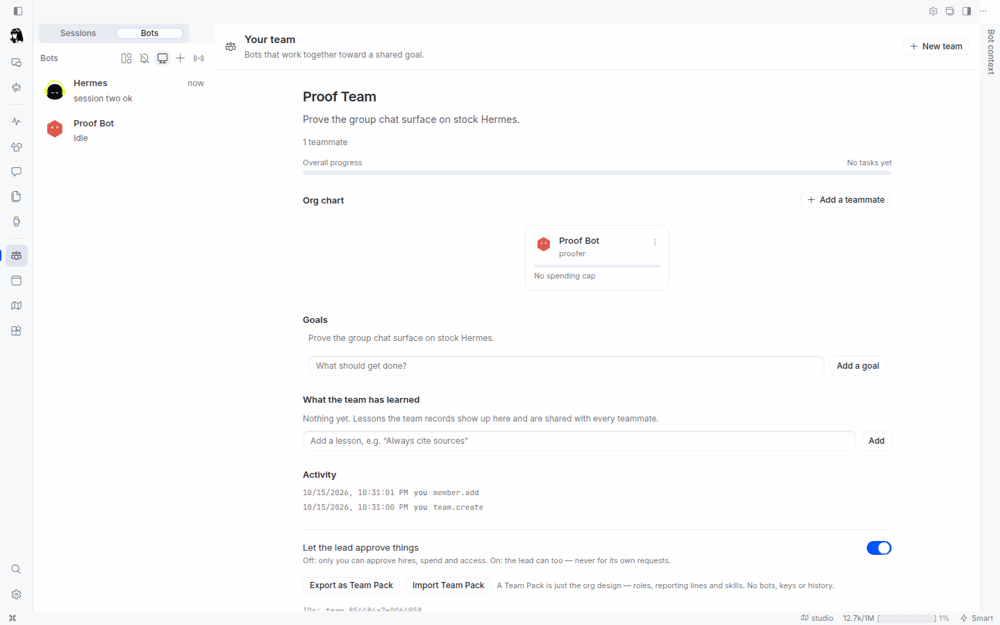
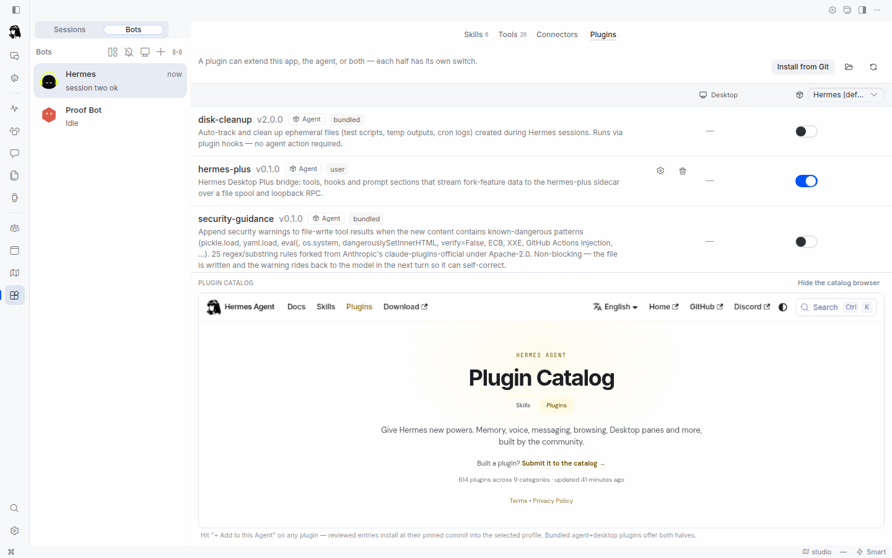

# Hermes Desktop Plus

The Hermes desktop app (sessions, group chat, tool cards, bot mode, team mode,
plugin rail) as an add-on for stock [Hermes Agent](https://github.com/NousResearch/hermes-agent),
served to any browser.

Hermes Desktop Plus never patches Hermes. A sidecar in its own virtualenv serves
the web UI, multiplexes the gateway connection, and fronts a loopback-only stock
`hermes dashboard`. Upgrading Hermes stays one command.

## Install

You need stock Hermes Agent on your `PATH` and either [uv](https://astral.sh/uv)
or pipx. The installer finds `hermes`, installs the sidecar into its own tool
environment, copies the bridge plugin into your Hermes home, and finishes with
`hermes-plus doctor`. If Hermes is missing and you set
`HERMES_PLUS_INSTALL_HERMES=1`, the installer runs upstream's installer pinned to
Hermes Agent `v0.22.1`.

On a machine that already runs stock Hermes, the first install takes about three
minutes (nearly all of it downloading the sidecar's Python dependencies) and about
ten seconds after that; Hermes itself is never rebuilt.

```sh
curl -fsSL https://raw.githubusercontent.com/DECRUX9812/hermes-desktop-plus/v0.1.0/install.sh | sh
```

Without the script:

```sh
uv tool install https://github.com/DECRUX9812/hermes-desktop-plus/releases/download/v0.1.0/hermes_plus-0.1.0-py3-none-any.whl
hermes-plus install
```

From a clone (development). This is the sequence `proof/run-proof.sh` and CI use:

```sh
cd hermes-desktop-plus

# Build the web UI (Node.js 22; the repo uses npm workspaces)
npm ci
npm --prefix packages/ui run build:webapp

# Stage the built UI into the Python package
rm -rf packages/hermes_plus/src/hermes_plus/ui_dist
mkdir -p packages/hermes_plus/src/hermes_plus/ui_dist
cp -a packages/ui/dist-webapp/. packages/hermes_plus/src/hermes_plus/ui_dist/

# Build the wheel and install from it
uv build --wheel packages/hermes_plus --out-dir dist
HERMES_PLUS_SOURCE="$(ls dist/hermes_plus-*.whl)" ./install.sh
```

## Serve over the web

```sh
hermes-plus serve --host 127.0.0.1 --port 9129
```

`serve` prints a one-time login URL (`http://127.0.0.1:9129/?token=...`). Open it
once; the browser keeps a session cookie after that. The default `--auth` is
`token`.

Other auth modes, from `hermes-plus serve --help`:

```sh
hermes-plus serve --host 0.0.0.0 --port 9129 --auth password --password-file ~/.hermes-plus-password
```

`--auth` is `token` (default), `password`, or `none`. `none` is refused on a
non-loopback host. Add `--trust-proxy-headers` when a reverse proxy terminates
authentication.

Quick public URL through a Cloudflare tunnel:

```sh
cloudflared tunnel --url http://127.0.0.1:9129
```

Put **Cloudflare Access** (Zero Trust SSO/MFA) in front of the hostname. The
sidecar is the only process reachable from the internet; stock Hermes stays on
loopback.

Before exposing it to anything, read **[docs/security.md](docs/security.md)**:
what the front door protects, what a share link or the host terminal exposes, and
what to configure on a tunnel (`--auth password`, `--trust-proxy-headers`,
`X-Forwarded-Host`, `HERMES_PLUS_ALLOWED_ORIGINS`).

## Docker

```sh
cp docker/.env.example docker/.env      # set HERMES_PLUS_PASSWORD
docker compose -f docker/compose.yaml up -d --build
```

Then open `http://127.0.0.1:9129`. The image is a thin layer on the official
`nousresearch/hermes-agent` image; `HERMES_TAG` picks the Hermes release
(default `v0.22.1`). The compose file has a `tunnel` profile for Cloudflare Tunnel.
See `docker/README.md`.

## Upgrading

```sh
hermes update          # upstream's own command; never touches this add-on
hermes-plus update     # upgrade the sidecar, re-copy the bridge, migrate
hermes-plus doctor     # re-check compatibility
```

`hermes-plus update --check` prints the upgrade command without running it, and
exits 0 when there is nothing newer published.

Upgrades are designed to be safe: Hermes's files and virtualenv are never
modified, `hermes-plus` lives in its own environment, and the bridge plugin uses
only Hermes's public plugin API. `doctor` re-runs the compatibility check
afterwards. Hermes `v0.22.2` (`d923a5e`) is a known-good release: the adapter
contract suite was run against it.

## Uninstall

```sh
hermes-plus uninstall                 # disable + remove the bridge plugin
hermes-plus uninstall --purge --yes   # also delete plus.db and uploaded files
uv tool uninstall hermes-plus         # remove the sidecar itself (or: pipx uninstall hermes-plus)
```

`uninstall` without `--purge` keeps `plus.db` and uploaded files, so a
reinstall picks up where you left off. It disables the plugin in Hermes's config
and does not touch Hermes's own files.

## Compatibility

Generated from `packages/hermes_plus/src/hermes_plus/compat/matrix.json` by
`scripts/render-compat-table.py`:

| Field | Value | Meaning |
| --- | --- | --- |
| Adapter API | `1` | Wire contract between the sidecar and the adapter. |
| Minimum | `0.22.0` | Below this, `serve` refuses and `doctor` explains the fix. |
| Known good releases | `0.22.0`, `0.22.1`, `0.22.2` | Full feature set, contract-tested in CI. |
| Known good commits | `379cf12`, `297552a`, `d923a5e`, `607a0b0d` | Abbreviated upstream shas accepted as known-good. |
| Tested main | `607a0b0d` | The upstream main commit nightly tracks. |
| Newest tested minor | `0.22` | A newer minor is served with a banner, features gated on capability probes. |

A version above the minimum that is not listed is **untested**: the server runs,
prints a banner, and hides any feature whose upstream methods or events are
missing. A version below the minimum is **unsupported** and `serve` refuses.

## How it works

```
browser ──> hermes-plus sidecar :9129  (our process, our venv, our auth)
              ├─ serves the web UI + our own HTTP routes (uploads, share, mobile, plugins)
              ├─ /api/ws  multiplexer: our method namespaces here, everything else forwarded
              └─ adapter ──loopback WS + CLI──> stock `hermes dashboard` (child, 127.0.0.1)
                                                   └─ loads $HERMES_HOME/plugins/hermes-plus/
                                                      bridge plugin (stdlib-only, public ctx API)
```

## Screenshots

Captured by the clean-install proof on stock Hermes
(`proof/run-proof.sh`).

<!-- tool-card and bot-pane shots: added after the deterministic proof run -->














## FAQ

**Does it modify Hermes?**
No. Hermes is stock and untouched. The sidecar and the bridge plugin are the
only additions, and the bridge plugin uses Hermes's documented plugin API.

**Where is my data?**
Everything of ours lives under your Hermes home, in
`<HERMES_HOME>/hermes-plus/`: `plus.db` (SQLite) plus uploaded files under
`hermes-plus/files/`. Hermes's own sessions, config and credentials stay in
their usual places and are never copied into our database.

## Contributing

See `CONTRIBUTING.md`. The short version: only `adapter/` and `bridge/` may know
anything about Hermes internals, and tests use real processes and a real stock
Hermes, never mocks.

## License

MIT. See `LICENSE`. The web UI is derived from Hermes Agent's MIT-licensed
desktop app; see `NOTICE`.
